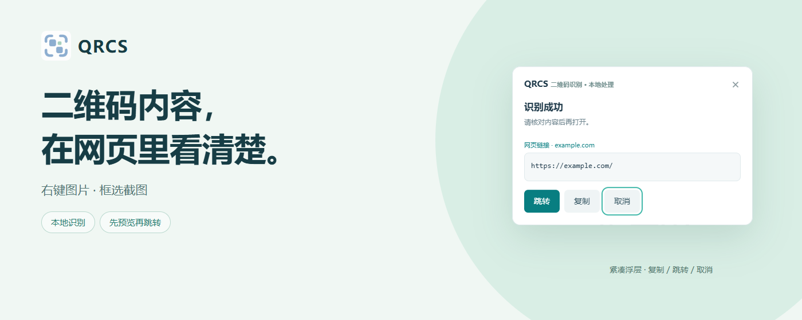
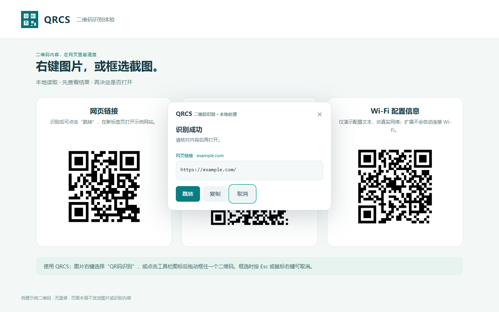
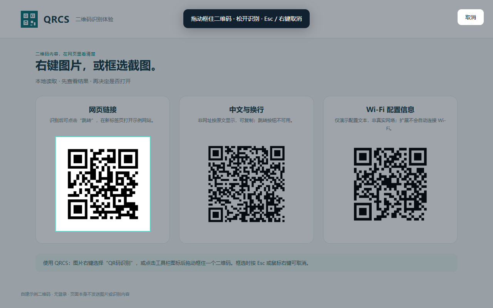

<p align="center">
  
</p>

<h1 align="center">QRCS 二维码识别</h1>

<p align="center">
  右键图片，或框选截图。直接在网页里查看二维码内容。
</p>

<p align="center">
  
  
  <a href="https://github.com/HeartLessWhiteWolf/QRCS/releases/download/v1.0.3/QRCS-1.0.3.zip"></a>
</p>

<p align="center">
  <a href="https://github.com/HeartLessWhiteWolf/QRCS/releases/download/v1.0.3/QRCS-1.0.3.zip"><strong>下载扩展 ZIP</strong></a>
  · <a href="#安装">安装指南</a>
  · <a href="#使用方式">使用方式</a>
  · <a href="https://github.com/HeartLessWhiteWolf/QRCS/issues">反馈问题</a>
</p>

<p align="center">
  
</p>

## 功能

- **右键图片识别** — 在二维码图片上右键，选择「QR码识别」。
- **框选网页截图** — 点击扩展图标，拖动框住二维码；背景图、Canvas 和视频画面也可以这样读取。
- **紧凑结果浮层** — 显示完整内容，支持跳转、复制、取消和 `Esc` 退出；结果不另开独立系统窗口。
- **本机解码** — 解码器随扩展打包，图片和截图不上传给在线识别服务，无需登录。
- **多种内容与样式** — 读取链接、中文文本、Wi-Fi 配置、名片等内容；可尝试识别旋转、反色、彩色及美化二维码，多条结果可切换查看。

## 安装

目前提供 ZIP 手动安装，无需 Node.js 或其他开发工具。

1. **[下载 QRCS 1.0.3](https://github.com/HeartLessWhiteWolf/QRCS/releases/download/v1.0.3/QRCS-1.0.3.zip)**，解压到准备长期保留的文件夹。
2. 在 Microsoft Edge 地址栏打开 `edge://extensions/`，开启「开发人员模式」。
3. 点击「加载解压缩的扩展」，选择解压后**直接包含 `manifest.json`** 的文件夹。
4. 在扩展菜单中找到「QRCS 二维码识别」，将图标固定到工具栏即可开始使用。

更新时替换原加载目录中的文件，点击扩展管理页的「重新加载」，再刷新目标网页。完整步骤见 [安装与使用](docs/INSTALL.zh-CN.md)。

<details>
<summary>从仓库源码安装</summary>

```bash
git clone https://github.com/HeartLessWhiteWolf/QRCS.git
```

在扩展管理页加载仓库中的 `extension/` 文件夹。运行所需的解码器和图标已经包含在仓库中，无需先构建。

</details>

## 使用方式

### 图片右键

在图片上右键 → **QR码识别** → 查看内容 → 选择**跳转 / 复制 / 取消**。

有效的 HTTP / HTTPS 链接可以在新标签页打开；文本、Wi-Fi 配置和应用专用链接等保留原文供复制使用。识别完成后不会自动跳转。

如果图片被网页遮罩覆盖，或二维码是画布、背景图，右键 **QR码识别** 会进入框选模式；也可直接点击工具栏图标框选。

### 截图框选

点击工具栏图标 → 拖动框住完整二维码与四周留白 → 松开鼠标识别。按 `Esc` 或鼠标右键可取消框选。

<table>
  <tr>
    <td align="center"><strong>网页内直接查看结果</strong></td>
    <td align="center"><strong>拖动框选二维码</strong></td>
  </tr>
  <tr>
    <td><a href="publishing/assets/screenshot-01-result-1280x800.png"></a></td>
    <td><a href="publishing/assets/screenshot-02-selection-1280x800.png"></a></td>
  </tr>
</table>

## 隐私

二维码在设备本机解码。QRCS 没有账号、广告、分析服务或扫码历史功能，截图与识别内容不上传给开发者或在线识别服务。

读取网络原图时会请求图片原站；只有点击「跳转」才访问二维码目标网站，点击「复制」才写入系统剪贴板。任务通过会话存储临时传递，详细处理方式见 [隐私政策](publishing/privacy-policy.zh-CN.md)；权限用途见 [权限说明](docs/PERMISSIONS.md)。

## 常见问题

<details>
<summary>为什么有时显示在工具栏弹层里？</summary>

普通网页优先显示页内浮层。独立 `data:` 图片等受限页面无法注入界面时，会使用紧凑的工具栏弹层；若没有自动展开，点击扩展图标上的 `QR` 标记即可。

</details>

<details>
<summary>二维码没有识别出来怎么办？</summary>

完整框住四角及周围留白，尝试放大网页后重新截图。多个二维码可分别框选。严重模糊、遮挡、损坏或特殊艺术码无法保证成功。

浏览器内部页、扩展商店、PDF 阅读器和本地文件等也可能受到截图或脚本访问限制。

</details>

<details>
<summary>可以用在其他浏览器上吗？</summary>

QRCS 使用 Chromium 通用的 Manifest V3 扩展接口，面向桌面 Microsoft Edge，最低要求 Chromium 127。其他兼容浏览器可以尝试加载同一份扩展；具体版本的兼容性需要各自验证。

</details>

## 反馈与开发

遇到问题可 [提交 Issue](https://github.com/HeartLessWhiteWolf/QRCS/issues)，说明浏览器版本、QRCS 版本及复现步骤。公开截图前请检查其中的二维码和网页内容是否适合分享。

- [开发指南](docs/DEVELOPMENT.md) · 本地运行、测试、打包与代码结构
- [更新记录](docs/CHANGELOG.md)
- [验证范围](docs/TESTING.md)
- [商店发布材料](publishing/README.md)

由 **Xpovoc** 维护 · [wighowolf@gmail.com](mailto:wighowolf@gmail.com)

感谢 [jsQR](https://github.com/cozmo/jsQR) 和 [ZXing-C++ / zxing-wasm](https://github.com/Sec-ant/zxing-wasm) 提供解码能力。第三方许可证与来源见 [vendor 声明](extension/vendor/THIRD-PARTY-NOTICES.txt)。
